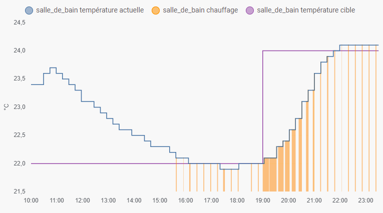

# HASmartThermostat

## Smart Thermostat with PID controller for Home Assistant

Create a virtual thermostat with accurate and reactive temperature control through PID controller.
[Principle of the PID controller](https://en.wikipedia.org/wiki/PID_controller).
Any heater or air conditioner unit with ON/OFF switch or pilot wire can be controlled using a pulse
width modulation (PWM) that depends on the temperature error and its variation over time. Continuous or analog
devices (valves, lights, input numbers, slave thermostats) are driven directly using their native position or setpoint values.

---

## Documentation Navigation

To keep the documentation clean and comprehensive, detailed guides have been separated into dedicated pages:

- 🚀 **[Installation Guide](docs/installation.md)** — Step-by-step setup using HACS or manual installation.
- ⚙️ **[Configuration & Examples](docs/configuration.md)** — Basic setup, configuration examples, and cascading PIDs.
- 📐 **[PID Principles & Tuning Guide](docs/pid_tuning.md)** — How PID control works, equations, derivative filter setup, outdoor compensation, and tuning tutorials.
- 📖 **[Parameters Reference](docs/parameters.md)** — Full itemized parameter reference categorized by features.
- 🛠️ **[Services Reference](docs/services.md)** — Available Home Assistant services (`set_pid_gain`, `set_derivative_filter`, `set_pid_mode`, `set_preset_temp`, `clear_integral`).
- 🤖 **[Autotune Guide](docs/autotune.md)** — Experimental automatic PID tuning guide and available rules.

---

## Quick Summary

- **Digital / ON-OFF devices** (e.g., `switch`): Controlled via Pulse-Width Modulation (PWM) duty cycles.
- **Analog / Continuous devices** (e.g., `valve`, `light`, `fan`, `climate`, `number`, `input_number`): Controlled directly via absolute setpoints or percentages.
- **Dual Heat/Cool support**: Seamlessly manage heating and cooling with dedicated entities and gains.

> [!WARNING]
> **Do not mix `climate` entities with other analog types** (such as `switch`, `valve`, `light`, or `number`) within the same `heater` or `cooler` list due to mismatched control ranges.

---

### Credits

This code is a fork from Smart Thermostat PID project:
<https://github.com/aendle/custom_components>

The python PID module with Autotune is based on pid-autotune:
<https://github.com/hirschmann/pid-autotune>